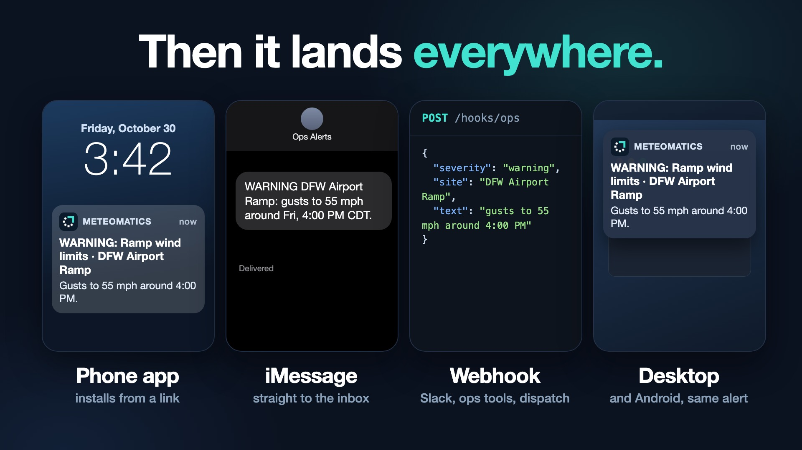

# BreakingWX Alerts

Threshold-based weather alerting for **retail, insurance, energy, and aviation ground ops**.
Meteomatics forecasts in, rules evaluated on a schedule, alerts out over iMessage, webhooks, and more.

[](promo/brag.mp4)

*Watch the promo: [promo/brag.mp4](promo/brag.mp4)*

```
Meteomatics REST ─► poller ─► rules engine ─► state machine ─► channels
                                (AND of conditions,           ├─ imessage_business  (Apple Messages for Business via MSP)
                                 lookahead window,            ├─ imessage_mac        (Mac signed into Messages; personal/beta)
                                 cooldown, clear notices)     ├─ webhook             (Slack relay, ops tools, trading desks)
                                                              └─ console
```

## Run it

```bash
npm run demo     # MOCK=1: synthetic storm + seeded rules for all four sectors. No credentials needed.
npm test         # 20 tests
npm run typecheck
```

Open http://127.0.0.1:8787. For real data:

```bash
cp .env.example .env     # fill METEOMATICS_USER / PASS, API_KEY, WEBHOOK_SECRET
set -a; . ./.env; set +a; npm start
```

Requires Node 24+. No runtime dependencies (built-in `node:sqlite`, native TypeScript).

## How rules work

A rule has 1–6 **conditions** (all must be true), e.g. `wind_gusts_10m_1h:mph  max  >=  45` over the next *N* hours.
`agg` is `max | min | sum | avg | first`. Per (rule, location):

- **clear → active**: conditions match. Alert sent unless inside the rule's **cooldown** (flap protection).
- **active → clear**: conditions stop matching *with complete data*. Optional "CLEARED" notice.
- A provider failure or missing data **never** changes state, so an outage can't fake an all-clear.

Messages support `{{severity}} {{rule}} {{location}} {{summary}} {{v0}} {{t0}}` (value and local time of condition 0, `{{v1}}` for condition 1, …).
Times are rendered in each location's IANA time zone.

## Industry templates (`src/templates.ts`)

| Sector | Templates |
|---|---|
| Retail | high wind, snow, extreme heat (cold chain), heavy rain |
| Insurance | hail, severe thunderstorm wind, flood rainfall, hard freeze |
| Energy | cold snap, heat wave, wind high (cut-out), wind lull, low solar, line-damaging gusts |
| Aviation ops | lightning, ramp wind, low visibility, low ceiling, de-icing, snow clearing |

Thresholds are starting points. Tune to your SOPs. Supported parameters live in `src/params.ts`
(verified against the Meteomatics `mix` model; some, such as freezing rain, are not available on all plans/models).

## iMessage: what's real

There is no official iMessage API. Two paths are implemented:

1. **`imessage_business`**: Apple Messages for Business through a Messaging Service Provider (Sinch, Twilio, Bandwidth, Infobip…).
   Not SMS, so no A2P 10DLC. Apple requires you to be an approved business and the **customer must text first**.
   `POST /webhooks/imessage-business` (header `x-webhook-secret`) takes `{ "from": "...", "text": "START" }` and
   records the opt-in (`STOP` opts out). Alerts only go to opted-in recipients. `src/channels/index.ts` posts a normalized
   payload to `IMESSAGE_BUSINESS_URL`; adjust it to your MSP's schema.
2. **`imessage_mac`**: a Mac signed into Messages, driven by AppleScript, serialized with a minimum gap.
   Enable with `IMESSAGE_MAC_ENABLED=1`. **Personal / small-beta use only**: it is not Apple-supported, can be
   rate-limited or locked, and isn't suitable for commercial scale.

## API (all `/api/*` need `Authorization: Bearer $API_KEY` when `API_KEY` is set)

`GET /api/meta` · `GET|POST /api/locations` · `GET|POST /api/recipients` · `POST /api/recipients/:id/test` ·
`GET|POST /api/rules` · `PUT|DELETE /api/rules/:id` · `POST /api/rules/:id/dry-run` ·
`POST /api/templates/:key/apply` · `GET /api/alerts` · `POST /api/run`

## Phone app: anyone with credentials

People install the app on their phone, sign in with credentials you give them, and receive alerts as push notifications. No Apple or carrier registration is involved.

1. **Create credentials**: admin dashboard → **Users** → *Create credentials*. The password is shown once. Send them the link `https://YOUR-HOST/app`, their username, and the password.
2. **They install it**: on iPhone/iPad, open the link in **Safari → Share → Add to Home Screen**, then open *WX Alerts* from the Home Screen (iOS delivers push only to installed apps, iOS 16.4+). On Android, open it in Chrome and accept the install prompt.
3. **They turn on alerts**: sign in, tap **Turn on alerts**, allow notifications.
4. **You choose what they get**: each user has a `push` recipient named after their username. Attach it to rules (Rules tab, or when applying templates). They only ever see alerts that were sent to them.

**This needs public HTTPS.** Phones will not register for push on plain `http://` or `localhost`. Options:
- Quick test: `cloudflared tunnel --url http://localhost:8787` gives a temporary `https://….trycloudflare.com` URL.
- Real use: put the server behind a stable HTTPS domain (a small VPS, Fly.io, Render, or a named Cloudflare Tunnel), then set in `.env`: `TRUST_PROXY=1`, `COOKIE_SECURE=1`, and `VAPID_SUBJECT=mailto:you@yourdomain.com`.
- The admin dashboard lives at the same host (`/`). It requires `API_KEY`, but also consider restricting `/` and `/api` at the proxy to your own IP or an access policy.
- Keep the `data/` folder backed up: it holds users and device registrations. Changing the VAPID keys breaks every existing device registration.

Security notes: passwords are scrypt-hashed, sessions are random tokens stored hashed (30 days, HttpOnly, SameSite=Lax), logins are rate-limited, push endpoints are restricted to known push services, and state-changing user routes require JSON (CSRF guard).

## Proof of delivery, acknowledgement, escalation

Push alone can't prove an alert arrived. These pieces close that gap:

- **Receipts:** when a push reaches a phone, the app's background worker reports back (identified by the device's push endpoint). The dashboard shows "Received on phone: jim 1:11:04 PM" on each alert.
- **Got it:** each alert in the app has a **Got it** button (Android and desktop also show it on the notification). Acknowledgements appear in the dashboard.
- **Escalation:** on a rule, set *Escalate if nobody acknowledges within N minutes* and pick who else to notify. A separate one-minute timer sends an "ESCALATED" alert if nobody who received it on the phone app pressed Got it. It does not escalate when the alert was never delivered by push (nothing to acknowledge), when conditions have already ended, or when someone already acknowledged; and never twice.
- **Reachability:** the app reports its permission state each time it opens. Users tab shows **ready / check / unreachable** per person with the last confirmation time, plus a **Test** button. "Check" means not confirmed in 7 days.
- **Monitoring heartbeat:** the app shows "Monitoring active · last checked N min ago", and turns red if checks stop or amber if the weather data source is failing, so silence is never mistaken for all clear.
- **Not-ready banner:** people who haven't enabled alerts (or blocked them) see a red "You won't get alerts" card with the exact fix.

iPhone web push does not show action buttons on notifications, so iPhone users acknowledge inside the app.

## Before production

- **Users receive alerts; you manage rules.** Subscribers don't create their own locations or rules yet. Self-serve rule building for customers needs per-user ownership of locations, rules, and recipients.
- Add TLS (reverse proxy), real auth/SSO for the UI, and rate limiting. The server binds to localhost by default.
- Webhook recipient URLs are admin-supplied and fetched server-side; add an allowlist or SSRF guard before exposing recipient creation to customers.
- Verify messaging consent/opt-out handling with counsel for each channel and region.
- Add an SMS channel only if customers insist (that is where 10DLC returns).
- Ideas next: live METAR/TAF/SIGMET triggers for aviation (Meteomatics `get_opmet`), ensemble-probability rules for energy, web push (PWA) channel, escalation chains and on-call schedules, quiet hours.

## Run at login (macOS)

```bash
sed "s#__PROJECT_DIR__#$PWD#g" deploy/com.breawx.alerts.plist.template > ~/Library/LaunchAgents/com.breawx.alerts.plist
launchctl load ~/Library/LaunchAgents/com.breawx.alerts.plist
```

`run.sh` loads `.env` and starts the server; edit the Node path in it if yours is not `/usr/local/bin/node`.

## Development

```bash
npm install
cp .env.example .env     # fill in credentials, or run `npm run demo` with mock data
npm run typecheck
npm test
```

Requires Node 24+ (runs TypeScript natively, no build step). CI runs typecheck and tests on every push.

## License

MIT
